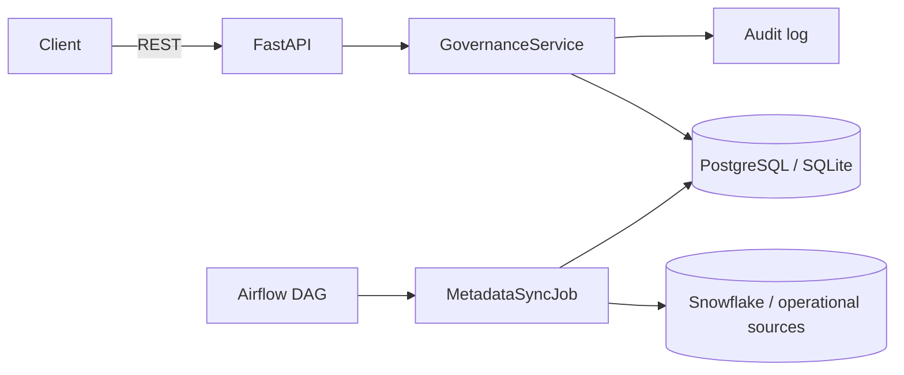

# data-governance-service

> An authoritative record of **data assets, ownership, and access** — with an
> approval workflow, an append-only **audit log**, and a **metadata sync** job
> that keeps the catalog current and flags stale or incomplete entries. Built on
> FastAPI + SQLAlchemy + Pydantic; the sync runs on Airflow against Snowflake in
> production.


> ℹ️ An **original reference implementation** demonstrating data-governance
> engineering. No proprietary code or data.

---

## What it does

- **Asset catalog** — register data assets with a source system, owner and
  classification. Assets missing an owner or classification are **incomplete**.
- **Access workflow** — users request access with a reason; a steward approves
  or denies. Approval creates a **grant**; grants can be revoked.
- **Audit log** — every registration, request, decision, grant and revocation is
  written to an append-only log, in the same transaction as the action.
- **Metadata sync** — a job pulls asset metadata from source systems (Snowflake /
  operational DBs), upserts the catalog, and marks assets that disappeared as
  **stale**. Scheduled by Airflow in production.
- **Governance report** — lists incomplete and stale assets for review.

## Architecture



- **Service layer** owns the rules and writes audit entries transactionally.
- **Persistence** is SQLAlchemy 2 over PostgreSQL (SQLite for local/dev/tests).
- **Metadata source is a port** (`MetadataSource`): a Snowflake adapter in prod,
  a static fake in tests — so the sync/flagging logic is tested without a
  warehouse. The [Airflow DAG](dags/metadata_sync_dag.py) schedules it.

---

## API

| Method | Path | Purpose |
| --- | --- | --- |
| `POST` | `/api/assets` | Register a data asset |
| `GET`  | `/api/assets` | List assets |
| `POST` | `/api/access-requests` | Request access to an asset |
| `POST` | `/api/access-requests/{id}/decide` | Approve / deny (approval → grant) |
| `GET`  | `/api/grants?principal=` | List a principal's grants |
| `POST` | `/api/grants/{id}/revoke?actor=` | Revoke a grant |
| `GET`  | `/api/governance/report` | Incomplete + stale assets |
| `POST` | `/api/metadata/sync` | Run a metadata sync from posted items |

---

## Run it

```bash
pip install -e ".[dev]"
python -m governance            # http://localhost:8000/docs (SQLite by default)

# or with Postgres:
docker compose up --build
```

## Tests

```bash
pytest -q
```
Covers the access workflow (request → approve/deny → grant → revoke), audit-log
writes, the metadata sync's upsert + stale/incomplete flagging (with a faked
source), and the REST API end to end — all on in-memory SQLite, no external
services.

---

## Design decisions

- **Audit entries in the action's transaction** — the log can never disagree with
  what actually happened.
- **Metadata source as a port** — Snowflake in prod, fake in tests; the flagging
  logic is pure and fully covered.
- **SQLite for tests, Postgres for real** — fast, hermetic CI without losing a
  production-accurate deployment.
- **Derived governance state** — `is_complete` and `stale` are computed/maintained
  rather than hand-set, so the report reflects reality.

---

*An original reference implementation. No proprietary code, data, or confidential information is included.*
